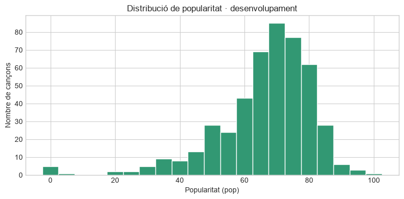
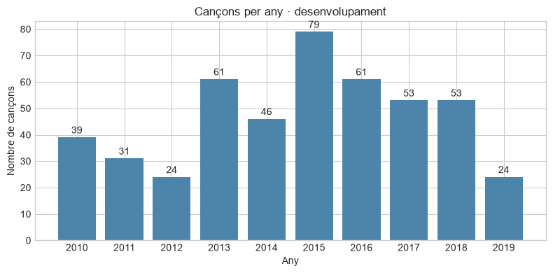
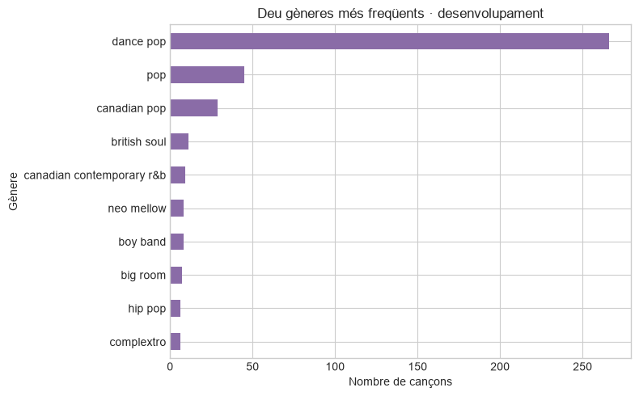
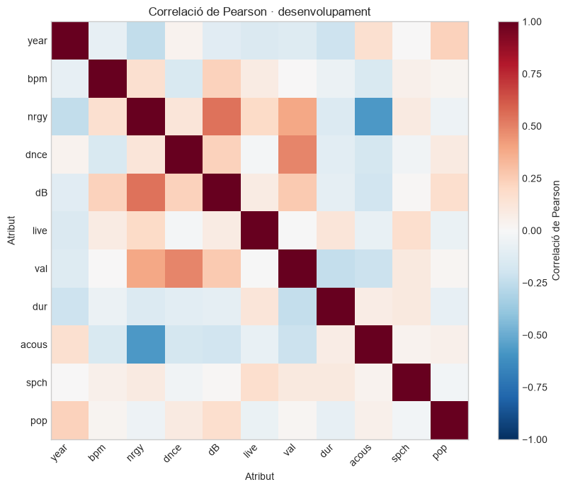
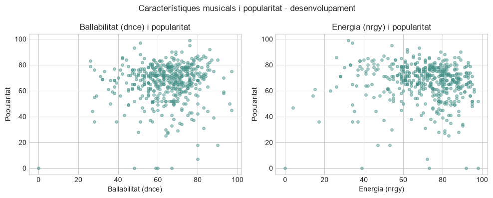
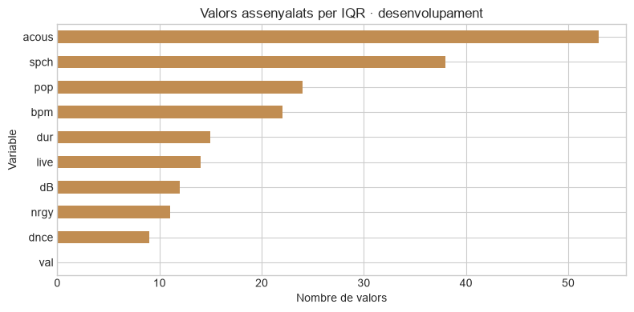

# Cas Kaggle · Cançons de Spotify (2010–2019)

> EDA completada. La comparació de models i els resultats finals estan pendents.

## 1. Pregunta i dades

Volem estudiar si podem **estimar la puntuació de popularitat `pop`** d’una cançó a partir de les seves característiques. És un problema de **regressió**: predirem una puntuació numèrica, no una etiqueta de gènere.

La font és [Top Spotify songs from 2010–2019 – BY YEAR](https://www.kaggle.com/datasets/leonardopena/top-spotify-songs-from-20102019-by-year), publicada per Leonardo Henrique. La descripció de Kaggle indica que les cançons són una selecció anual de temes populars, amb dades procedents d’Organize Your Music i basades en Billboard. El fitxer inclou **603 files** i 14 columnes útils, a més d’un índex que descartem com a predictor.

La font no documenta prou bé el criteri exacte de selecció ni quan es va obtenir la puntuació `pop`. Per això, el projecte estudia les dades disponibles i **no permet afirmar que predigui l’èxit futur d’una cançó**. A més, la mostra no representa totes les cançons de Spotify: ja està filtrada a temes seleccionats com a populars.

## 2. Partició i protocol

Hi ha artistes amb més d’una cançó. Per simular l’avaluació amb **artistes no presents en l’entrenament**, agrupem per nom d’artista normalitzat i fem `GroupShuffleSplit(test_size=0.2, random_state=42)`. Això reserva el 20 % dels **artistes**, no necessàriament el 20 % de les files:

| Conjunt | Cançons | Artistes |
|---|---:|---:|
| Desenvolupament | 471 | 147 |
| Test reservat | 132 | 37 |

Cap nom d’artista normalitzat no apareix a tots dos conjunts. Aquest criteri no garanteix detectar totes les possibles variants de nom o col·laboracions i tampoc simula una predicció temporal.

Totes les xifres i figures de l’EDA següent corresponen a **desenvolupament**. El test queda reservat; la futura validació creuada haurà de respectar també els grups per artista. Qualsevol imputació, escalat o codificació apresos de les dades s’ajustaran dins dels pipelines i de cada fold.

## 3. Atributs

| Atribut | Significat | Tipus |
|---|---|---|
| `title` | Títol de la cançó | Text |
| `artist` | Nom de l’artista | Categòric |
| `top genre` | Etiqueta de gènere | Categòric |
| `year` | Any associat a la llista | Numèric discret |
| `bpm` | Tempo en pulsacions per minut | Numèric |
| `nrgy` | Energia | Numèric |
| `dnce` | Ballabilitat | Numèric |
| `dB` | Intensitat sonora, en decibels | Numèric |
| `live` | Indicador de presència en directe | Numèric |
| `val` | València musical | Numèric |
| `dur` | Durada | Numèric |
| `acous` | Acousticitat | Numèric |
| `spch` | Presència de veu parlada | Numèric |
| `pop` | Puntuació de popularitat | Objectiu numèric |

La descripció pública no aclareix tots els detalls de mesura ni el moment de càlcul de les variables. En particular, cal ser prudent en interpretar si una característica hauria estat disponible abans d’un ús hipotètic del model.

## 4. Qualitat de les dades

A desenvolupament no hi ha cel·les buides ni files completament duplicades. Hi ha **14 files que repeteixen una parella exacta de títol i artista**: podrien correspondre a aparicions en més d’una llista o a registres diferents. No les eliminem automàticament; revisarem si representen la mateixa gravació abans del modelatge. Com que el test es divideix per artista, aquestes repeticions exactes no travessen els dos conjunts.

Hi ha **5 valors `pop = 0`** a desenvolupament. La font consultada no explica si signifiquen una puntuació real o una dada no disponible. Els conservem per ara i els considerarem explícitament en l’anàlisi d’errors; no els convertim en nuls sense evidència.

## 5. Distribució de la popularitat

La popularitat a desenvolupament té una mediana de **69**, una mitjana de **66,42** i un rang observat de **0 a 99**. La meitat central està entre **60,5 i 76**.

La distribució permet definir una baseline que sempre prediu la mediana de l’entrenament. Proposem com a mètrica principal l’**error absolut mitjà (MAE)**, perquè expressa l’error en punts de popularitat. La baseline i la mètrica es calcularan mitjançant validació, abans d’obrir el test.

## 6. Distribució per any i gènere

El nombre de cançons per any és desigual: a desenvolupament hi ha entre 24 i 79 registres per any. Les comparacions temporals poden estar afectades tant per la selecció de cançons com pel moment desconegut en què es va calcular `pop`.

`dance pop` és el gènere més freqüent, amb **266 de 471 cançons**. Hi ha **46 etiquetes** a desenvolupament, i **31 tenen menys de cinc exemples**. Això dificulta fer conclusions fiables per gènere i obliga a tractar amb cura possibles categories desconegudes en validació. La selecció de gènere com a predictor s’haurà de justificar, tenint en compte que pot estar molt associat a l’artista.

## 7. Relacions entre atributs i popularitat

Apliquem **Pearson** per explorar relacions lineals. A desenvolupament, `year` té una correlació de **0,233** amb `pop`, i `dB` de **0,171**; la resta de correlacions individuals mostrades són més properes a zero.

Al mapa, vermell indica correlació positiva, blau negativa i un color proper al blanc indica correlació lineal feble. La diagonal val 1 perquè cada variable es compara amb ella mateixa.

Els núvols següents mostren que, per valors semblants de ballabilitat o energia, hi ha puntuacions de popularitat molt diferents. Això suggereix que aquestes variables per si soles poden no ser suficients, però la seva utilitat conjunta s’haurà de comprovar amb models.

## 8. Valors extrems

La regla de 1,5 vegades l’interval interquartílic assenyala, entre altres, **53 valors d’`acous`**, **38 de `spch`** i **24 de `pop`**. És una eina de revisió: un valor extrem no és necessàriament incorrecte. Els mantenim, incloent-hi els zeros de `pop`, i justificarem qualsevol tractament posterior.

## 9. Decisions inicials

- Objectiu: estimar `pop` com a regressió. No es tracta de preveure l’èxit d’un llançament futur.
- Predictors inicials: explorar les característiques musicals i decidir amb cura si incloure l’any i el gènere, en funció de la disponibilitat i la justificació. No utilitzarem l’índex, el títol ni el nom d’artista com a predictors inicials; l’artista sí que s’utilitza per separar i validar.
- Mètrica proposada: MAE; baseline: mediana calculada només amb entrenament.
